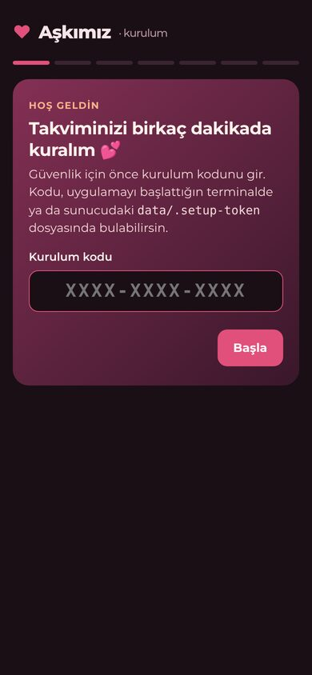
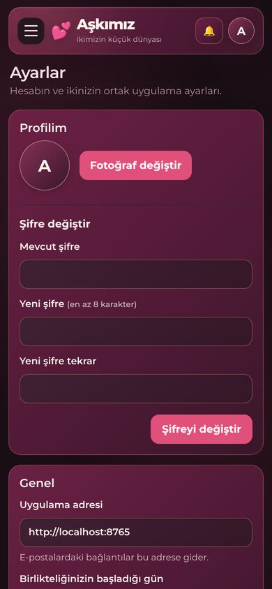

# Aşkımız 💕

**İki kişilik, kendi sunucunuzda çalışan ortak takvim ve küçük dünyanız.**

Buluşma planlarını öner, karşı taraf tek tıkla kabul etsin ya da başka gün önersin. Notlar, listeler, anılar ve özel günler de aynı yerde. Verileriniz başka bir şirkette değil, kendi sunucunuzda durur.

<p align="center">
  
  
  
</p>

**Neler var?**

- 📅 **Ortak takvim:** Öneri, kabul ya da başka gün önerme akışı. E-postadaki butonla tek tıkla cevap verilebilir.
- 📝 **Notlar:** Güne not bırakma ve ortak notlar.
- 🛒 **Listeler:** Alışveriş listeleri ve dilek listesi.
- 🎬 **İzleme listesi:** Birlikte izlenecek film ve diziler.
- 📍 **Mekanlar:** Gittiğiniz ve gitmek istediğiniz yerler. İkiniz ayrı ayrı puanlarsınız, bir de “🎲 Bugün nereye?” butonu var.
- 🎉 **Özel günler ve anılar:** Anılara isteğe bağlı olarak [Immich](https://immich.app) fotoğrafları eklenebilir.
- 📸 **Anlık fotoğraf:** Immich üzerinden birbirinize fotoğraf gönderme.
- 🔔 **Bildirimler:** Telefona uygulama gibi kurulabilir (PWA), anlık bildirim ve e-posta bildirimi gönderir.
- ⏳ **Sayaç:** “Birlikte geçen zamanımız” sayacı. Yıldönümlerini, her 100. günü ve aylık dönümleri kutlar, yaklaşanları da önceden haber verir.
- 💌 **Bekleyen planlar:** Ana sayfada uygulama içinden “Evet 🥰” ya da “Başka gün öner” denebilir. Kabul edilince ekranda kalpler uçuşur.
- ✉️ **Mektuplar (zaman kapsülü):** Seçtiğin anda açılan mektuplar. O ana kadar içerik karşı tarafa hiç gönderilmez, sadece kilitli bir zarf ve geri sayım görünür. Saat gelince “Sana bir mektup açıldı 💌” bildirimi gider.
- 🌙 **Kendi alanım modu:** Tek dokunuşla “biraz kendi alanımdayım”. Karşı taraf görür, sana gelen anlık bildirimler susar, döndüğünde neyi kaçırdığını görürsün. İstersen süre verirsin, süre dolunca kendiliğinden döner.
- 🐾 **Ares:** Boş ekranlarda sizi Blue Point maskotumuz Ares karşılar.
- ⚙️ **İlk açılış sihirbazı ve Ayarlar sayfası:** Hiçbir dosyayı elle düzenlemen gerekmez.

> **English:** Self-hosted shared calendar for couples. Run it with Docker (`docker compose up -d`) or Python (`pip install -r requirements.txt && uvicorn app:app`). Open it in your browser and follow the first-run setup wizard. The setup code is printed in the server log. The UI is in Turkish.

---

## Kurulum

İki yol var. Hangisini seçersen seç, ilk açılışta **kurulum sihirbazı** seni karşılar.

### A) Docker ile (önerilen)

```bash
git clone https://github.com/savasoyigit/valentine-calendar.git
cd valentine-calendar
docker compose up -d
docker compose logs askimiz        # kurulum kodunu buradan al
```

Sonra tarayıcıda `http://SUNUCU_IP:8000` adresini aç.

Veriler `askimiz-data` adlı bir Docker volume'ünde saklanır. Container silinse bile kaybolmaz.

### B) Python ile

Gerekenler: **Python 3.10 veya üzeri**.

```bash
git clone https://github.com/savasoyigit/valentine-calendar.git
cd valentine-calendar
python3 -m venv .venv
source .venv/bin/activate
pip install -r requirements.txt
uvicorn app:app --host 0.0.0.0 --port 8000
```

Bu kurulumda veriler proje içindeki `data/` klasörüne yazılır.

### İlk açılış sihirbazı

Uygulama ilk kez başladığında konsola (Docker'da `docker compose logs`) bir kurulum kodu yazar:

```
============================================================
  İLK KURULUM GEREKİYOR
  Tarayıcıda uygulamayı aç ve bu kurulum kodunu gir:

      82A1-9415-B0A3
============================================================
```

Bu kod, sunucun internete açıksa başkasının kurulumu senden önce yapmasını engeller. Kodu kaçırırsan `data/.setup-token` dosyasında da bulabilirsin.

| Adım | Ne soruluyor | Zorunlu mu? |
|---|---|---|
| 1. Temel bilgiler | Uygulamanın adresi, birlikteliğin başladığı gün | Adres zorunlu |
| 2–3. Kişiler | Ad (giriş adı da bu olur), e-posta, şifre, profil fotoğrafı | Ad ve şifre zorunlu |
| 4. Immich | Adres, API anahtarı, albüm adları. Bağlantıyı test etme butonu var | İsteğe bağlı |
| 5. E-posta | SMTP sunucusu, kullanıcı adı ve şifre. Test e-postası butonu var | İsteğe bağlı |

Şunları sihirbaz **kendisi üretir**:
- Oturum anahtarı
- Anlık bildirim (VAPID) anahtarları
- Şifre özetleri (PBKDF2-SHA256, 310.000 tur)

Ayarlar `data/config.json` dosyasına yazılır. Dosyayı yalnızca sunucu kullanıcısı okuyabilir. Kurulum bitince uygulama yeniden başlatmaya gerek kalmadan açılır.

---

## Ayarlar sayfası

Kurulumdan sonra her şey uygulamanın içinden değiştirilebilir. Sağ üstteki profil menüsünden **⚙️ Ayarlar**'a gir:

- **Profilim:** Profil fotoğrafı ve şifre değiştirme.
- **Genel:** Uygulama adresi ve birlikteliğin başladığı gün.
- **Fotoğraflar:** Immich bağlantısı. Bağlantıyı test edebilir, açıp kapatabilirsin.
- **E-posta bildirimleri:** SMTP ayarları. Test e-postası gönderebilir, açıp kapatabilirsin.

Kayıtlı şifreler ve anahtarlar sayfaya hiçbir zaman geri gönderilmez, sadece “kayıtlı” olarak görünür. İki kişi de ortak ayarları değiştirebilir.

---

## Nereden ne alınır?

**Immich API anahtarı**
Immich'i aç ve şu yolu izle: Profil resmi → **Hesap Ayarları** → **API Anahtarları** → **Yeni API Anahtarı**.

**Gmail ile e-posta göndermek**
Normal Gmail şifren burada çalışmaz. Önce Google hesabında 2 adımlı doğrulamayı aç. Sonra bir [uygulama şifresi](https://myaccount.google.com/apppasswords) oluştur ve onu kullan. Sunucu: `smtp.gmail.com`, port: `587`.

---

## https kurulumu

Ev ağında `http://192.168.x.x:8000` ile giriş yapıp uygulamayı kullanabilirsin. Ama tarayıcılar iki şey için **https** ister:
- **Anlık bildirimler**
- **"Ana ekrana ekle"** ile telefona uygulama gibi kurmak

Üç yol var:

| Yöntem | Alan adı gerekir mi? | Modemde port açmak gerekir mi? | Kim erişebilir? |
|---|---|---|---|
| **A) Tailscale Funnel** | Hayır | Hayır | İnternetteki herkes (giriş ekranı korur) |
| **B) Tailscale Serve** | Hayır | Hayır | Sadece Tailscale ağınızdaki cihazlar |
| **C) Caddy** | Evet | Evet (80 ve 443) | İnternetteki herkes (giriş ekranı korur) |

### A) Tailscale Funnel (en kolayı)

[Tailscale](https://tailscale.com), sunucuna `https://SUNUCU-ADI.AG-ADI.ts.net` gibi geçerli sertifikalı bir adres verir. Alan adı satın alman ya da modemde port açman gerekmez. Ücretsiz kişisel plan yeterli.

```bash
curl -fsSL https://tailscale.com/install.sh | sh    # Tailscale'i kur
sudo tailscale up                                    # çıkan linki tarayıcıda açıp giriş yap
sudo tailscale funnel --bg 8000                      # uygulamayı https ile internete aç
```

- **İlk seferde onay isteyebilir.** Hesabında Funnel ya da HTTPS sertifikaları henüz kapalıysa komut bir link verir. Linki açıp onayla, sonra komutu tekrar çalıştır.
- **Adresin çıktıda yazar.** "Available on the internet:" satırının altındaki `https://….ts.net` adresi senin uygulama adresindir.
- **Kalıcıdır.** `--bg` sayesinde ayar sunucu yeniden başlasa da açık kalır.

Sonra iki ayar yap:

1. **Uygulama adresini güncelle.** Uygulamada **⚙️ Ayarlar → Genel → Uygulama adresi** alanına bu `https://….ts.net` adresini yaz. E-postalardaki "Cevabını ver" linkleri bu adrese gider.
2. **Uygulamayı sadece Tailscale'den erişilebilir yap.** Böylece istekler hep Tailscale üzerinden ve https ile gelir.
   - **Python / systemd:** uvicorn'u `--host 127.0.0.1 --port 8000 --proxy-headers` ile çalıştır.
   - **Docker:** `docker-compose.yml` dosyasında iki satırı değiştir:
     ```yaml
     ports:
       - "127.0.0.1:8000:8000"
     environment:
       FORWARDED_ALLOW_IPS: "*"
     ```
     `"*"` burada güvenli, çünkü port artık sadece sunucunun kendisinden erişilebilir.

Tailscale isteği uygulamaya gerçek kullanıcı IP'si (`X-Forwarded-For`) ve https bilgisi (`X-Forwarded-Proto`) ile iletir. `--proxy-headers` bu bilgileri okur. Böylece:
- Hatalı giriş kilidi sadece deneme yapan kişiyi kilitler, ikinizi birden değil.
- Giriş çerezi `Secure` olarak işaretlenir.

Durumu görmek ya da kapatmak için:

```bash
tailscale funnel status
sudo tailscale funnel reset
```

### B) Tailscale Serve (sadece ikinize özel)

Uygulamanın internete hiç açılmamasını istiyorsan Funnel yerine Serve kullan:

```bash
sudo tailscale serve --bg 8000
```

- **Adres:** Yine `https://….ts.net` biçiminde olur, ama sadece Tailscale ağınızdaki cihazlardan açılır.
- **Telefonlar:** İkinizin telefonuna da Tailscale uygulamasını kurup aynı ağa eklemeniz gerekir.
- **E-postadaki linkler:** Sadece Tailscale açıkken çalışır.
- **Kapatmak için:** `sudo tailscale serve reset`

Gizlilik açısından en güvenli yol budur.

### C) Kendi alan adınla Caddy

Alan adın varsa Caddy sertifikayı kendisi alır. Modemde 80 ve 443 portlarını sunucuya yönlendirmen gerekir.

```
takvim.ornek.com {
    reverse_proxy 127.0.0.1:8000
}
```

- **Python kurulumunda:** uvicorn'a `--proxy-headers --forwarded-allow-ips=127.0.0.1` ekle.
- **Docker'da:** `docker-compose.yml` içindeki `FORWARDED_ALLOW_IPS` değerini vekilin IP'si yap.

Bunu yapmazsan hatalı giriş kilidi ikinizi birden kilitleyebilir.

---

## Sürekli çalıştırma (systemd, Python kurulumu için)

`/etc/systemd/system/askimiz.service`:

```ini
[Unit]
Description=Aşkımız takvim
After=network.target

[Service]
User=KULLANICI
WorkingDirectory=/home/KULLANICI/valentine-calendar
ExecStart=/home/KULLANICI/valentine-calendar/.venv/bin/uvicorn app:app --host 127.0.0.1 --port 8000 --proxy-headers
Restart=on-failure

[Install]
WantedBy=multi-user.target
```

```bash
sudo systemctl daemon-reload
sudo systemctl enable --now askimiz
journalctl -u askimiz -f      # ilk açılıştaki kurulum kodu burada görünür
```

---

## Güncelleme

```bash
git pull
docker compose up -d --build                                        # Docker
# ya da: pip install -r requirements.txt && sudo systemctl restart askimiz   # Python
```

Veritabanı şeması açılışta otomatik güncellenir, verilerin korunur.

## Yedekleme

Tüm verin tek bir klasörde durur: `config.json`, `askimiz.db` ve profil fotoğrafları.

```bash
# Python kurulumu
tar czf askimiz-yedek-$(date +%F).tgz data/

# Docker
docker run --rm -v valentine-calendar_askimiz-data:/data -v "$PWD":/yedek alpine \
  tar czf /yedek/askimiz-yedek-$(date +%F).tgz -C /data .
```

Volume'ün tam adını `docker volume ls` komutuyla görebilirsin. Yedek dosyasında şifre özetleri ve API anahtarları da var, onu güvenli bir yerde sakla. Immich fotoğrafları Immich'in kendi yedeğine dahildir.

## Kurulumu sıfırlama

`data/config.json` dosyasını sil ve uygulamayı yeniden başlat. Sihirbaz tekrar açılır.
- Takvim ve notlar **silinmez**.
- Herkes bir kez yeniden giriş yapar.

---

## Ayarları .env'den uygulamaya taşıma

Ayarların `.env` ile verildiyse Ayarlar sayfasında soluk görünürler ve uygulamadan değiştirilemezler. Bunlara şifre değiştirme de dahil. Uygulamadan düzenlenebilir olmaları için ayarları bir kez `data/config.json` dosyasına taşı:

```bash
cd ~/valentine-calendar
mkdir -p data && chmod 700 data
.venv/bin/python -c "
from dotenv import dotenv_values
import config_store
v = {k: x for k, x in dotenv_values('.env').items() if k in config_store.KNOWN_KEYS and x}
config_store.save_config(v); print(len(v), 'ayar taşındı')"
mv .env .env.eski
```

Ardından servis dosyasından `--env-file .env` ya da `EnvironmentFile=` satırını kaldır ve servisi yeniden başlat. Oturumlar açık kalır.

## Sihirbaz yerine ortam değişkenleri

Otomatik kurulum gibi durumlarda ayarları `.env` ile de verebilirsin:

```bash
cp .env.example .env      # doldur
uvicorn app:app --env-file .env        # Docker'da: docker-compose.yml içindeki env_file satırını aç
```

Ortam değişkenleri her zaman `data/config.json` dosyasından önceliklidir. Bu yüzden Ayarlar sayfasında soluk ve değiştirilemez görünürler. Zorunlu değişkenler (`SITE_SECRET`, `PEOPLE`, `LOGIN_CREDENTIALS`) tanımlıysa sihirbaz hiç açılmaz.

Yardımcı komutlar:

```bash
python3 create_login_credentials.py                     # LOGIN_CREDENTIALS satırı
python3 -c "from setup_wizard import generate_vapid_keys as g; p, k = g(); print(f'VAPID_PUBLIC_KEY={p}\nVAPID_PRIVATE_KEY={k}')"
```

---

## Geliştirme

```bash
pip install -r requirements-dev.txt
pytest -q
```

Testler kurulum sihirbazından girişe, tüm özelliklerden Ayarlar sayfasına kadar uçtan uca akışı dener. GitHub Actions her push'ta testleri Python 3.10, 3.12 ve 3.13'te çalıştırır ve Docker imajını derler.

```
app.py             Giriş noktası: ayarlar yoksa sihirbazı, varsa uygulamayı çalıştırır
core.py            Asıl uygulama (FastAPI)
index.html         Arayüz
settings_api.py    Uygulama içi Ayarlar sayfasının API'si
places_api.py      Mekanlar sekmesinin API'si
capsules_api.py    Mektuplar (zaman kapsülü) ve açılma zamanlayıcısı
space_api.py       Kendi alanım modu ve bildirim susturma
setup_wizard.py    İlk açılış kurulum sihirbazı (setup.html ile birlikte)
config_store.py    Ayarların okunması ve yazılması
security.py        Tüm yanıtlara eklenen güvenlik başlıkları
icons/             Uygulama ikonları
tests/             Uçtan uca testler
data/              (git'e girmez) config.json, veritabanı, profil fotoğrafları
```

## Güvenlik

- **Gizli dosyalar:** `data/` ve `.env` asla commit edilmemeli, `.gitignore` bunları zaten dışarıda bırakıyor.
- **Kurulum ekranı:** Kurulum bitince kurulum kodu silinir ve sihirbazın uç noktaları tamamen kapanır.
- **Şifreler:** PBKDF2-SHA256 (310.000 tur) ile özetlenerek saklanır. Kullanıcı yoksa bile aynı hesaplama yapılır, böylece cevap süresinden kullanıcı adı tahmin edilemez.
- **Hatalı giriş kilidi:** Üç ayrı sayaç var:
  - Aynı IP'den aynı kullanıcı adına 3 hatalı deneme o IP'yi o hesap için 30 dakika kilitler.
  - Aynı IP'den toplam 10 hatalı deneme o IP'yi tamamen 30 dakika kilitler.
  - Tüm IP'lerden bir hesaba toplam 30 hatalı deneme, dağıtık saldırılara karşı o hesabı geçici olarak kilitler.

  Daha önce başarıyla giriş yapılmış bir cihaz (tanınan cihaz) üçüncü sayaçtan muaftır. Böylece bir yabancı, çok sayıda IP kullansa bile sizi kendi cihazınızdan kilitleyemez. Ters vekil ya da Tailscale arkasında `--proxy-headers` şarttır, yoksa herkes aynı IP'den geliyor görünür.
- **Oturumlar:** Her giriş sunucuda ayrı bir oturum kaydıdır. Çerezde sadece rastgele bir anahtar durur, veritabanında da yalnızca onun özeti saklanır. Çerez `HttpOnly`, `SameSite=Lax`, https'te `Secure`, en fazla 1 yıl geçerlidir.
  - **Çıkış yap:** O cihazın oturumunu sunucuda siler. Çerez bir yere kopyalanmış olsa bile artık işe yaramaz. Diğer cihazlar açık kalır.
  - **Diğer tüm cihazlardan çıkış yap** (Ayarlar → Profilim): Bu cihaz dışındaki tüm oturumları kapatır.
  - **Şifre değişince:** Uygulamadan da `.env`'den de değişse o kişinin bütün eski oturumları geçersizleşir.
- **Gizlilik:**
  - Profil fotoğrafları dahil tüm veriler giriş gerektirir.
  - Mektupların içeriği açılma anına kadar alıcıya sunucudan hiç gönderilmez.
  - API şeması (`/openapi.json`) ve dokümantasyon sayfaları kapalıdır.
- **Tarayıcı başlıkları:** Uygulama başka sitelerin içine gömülemez (`frame-ancestors 'none'`, `X-Frame-Options`). Ayrıca `nosniff` açıktır, `Referrer-Policy: same-origin` e-postadaki tek kullanımlık linklerin dışarı sızmasını önler, https'te HSTS devreye girer.
- **Docker:** Container root olmayan bir kullanıcıyla çalışır.

## Lisans

[MIT](LICENSE)
